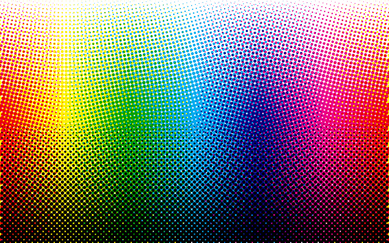
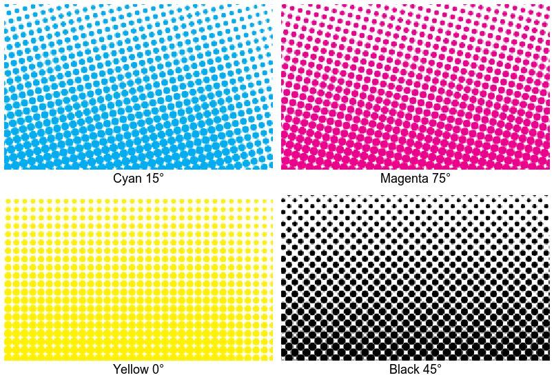
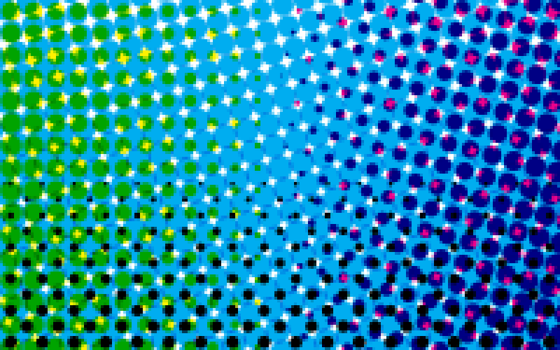
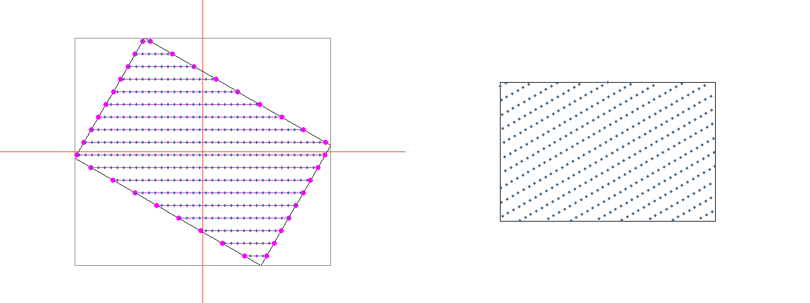

# Rotated grids in Rust

[](https://crates.io/crates/rotated-grid)
[](https://docs.rs/rotated-grid)
[](https://github.com/sunsided/rotated-grid/actions/workflows/rust.yml)

🎨 _For halftone dithering and more._

---

This crate provides a generator for enumerating grid coordinates at a specified frequency along a rotated grid.
This can come in useful e.g. when you want to create halftone dithering grids for CMYK processing:

<div align="center" style="text-align: center">
    
</div>

## Usage

```shell
cargo add rotated-grid
```

Describe the grid with `Grid` and iterate over it. Every yielded `GridCoord` lies inside the
`width` × `height` rectangle:

```rust
use rotated_grid::{Angle, Grid, GridCoord};

fn main() {
    let halftone_grids = [
        ("Cyan", 15.0),
        ("Magenta", 75.0),
        ("Yellow", 0.0),
        ("Black", 45.0),
    ];

    for (name, angle) in halftone_grids {
        println!("{name} at {angle}°");

        let grid = Grid::new(16.0, 10.0)
            .spacing(7.0, 7.0)
            .angle(Angle::from_degrees(angle));

        for GridCoord { x, y } in grid {
            println!("{x}, {y}");
        }
    }
}
```

All parameters can also be set as named fields:

```rust
use rotated_grid::{Angle, Grid};

let grid = Grid {
    width: 16.0,
    height: 10.0,
    dx: 7.0,
    dy: 7.0,
    x0: 0.0,
    y0: 0.0,
    angle: Angle::from_degrees(15.0),
};
let positions: Vec<_> = grid.into_iter().collect();
```

- `dx` and `dy` set the spacing along the rotated axes, `x0` and `y0` shift the grid along them.
- Any finite angle works. Positive angles turn the grid counter-clockwise in image
  coordinates, i.e. with the Y axis pointing down.
- Positions are generated row by row in rotated space. If you need them top to bottom,
  collect and sort them: `GridCoord` orders by `y`, then `x`.
- Non-positive spacings or sizes, and non-finite values, panic.

## In shaders

`rotated_grid::WGSL` contains WGSL functions that answer the inverse question per pixel: which
grid points are near this position? They use the same lattice as the iterator, so a fragment
shader can draw on exactly the points the iterator yields, from just the grid parameters:

```rust
use rotated_grid::{Angle, Grid};

let grid = Grid::new(800.0, 500.0)
    .spacing(8.0, 8.0)
    .angle(Angle::from_degrees(15.0));

// Write these eight values into a uniform buffer bound as `RotatedGrid` ...
let uniform: [f32; 8] = grid.to_uniform();

// ... and prepend the functions to your shader source.
let source = format!("{}\n{}", rotated_grid::WGSL, "/* your shader */");
```

```wgsl
@group(0) @binding(0) var<uniform> grid: RotatedGrid;

@fragment
fn fs_main(@builtin(position) position: vec4<f32>) -> @location(0) vec4<f32> {
    let dot = rotated_grid_nearest(grid, position.xy);
    let inside = distance(position.xy, dot) < 2.0;
    return select(vec4<f32>(1.0), vec4<f32>(0.0, 0.0, 0.0, 1.0), inside);
}
```

- `rotated_grid_nearest(grid, p)` returns the grid point nearest to `p`.
- `rotated_grid_neighbors(grid, p)` returns the four grid points around `p`, for shapes that
  can be larger than half the spacing, such as halftone dots in dark areas.
- `rotated_grid_cell`, `rotated_grid_point` and `rotated_grid_contains` work with lattice
  indices and the rectangle bounds.

## Demos

### CMYK halftone

```shell
cargo run --release --package cmyk
```

Prints a color gradient as a CMYK halftone. Each ink gets its own rotated grid, and the dot
size follows the amount of that ink at the dot. The inks multiply on white paper, just like
printed ink. Keys `1`–`4` toggle the inks, `+`/`-` change the dot spacing, `Space` shows
the source image and `Esc` quits.

<div align="center" style="text-align: center">
    
    <br/><em>The four screens on their own.</em>
</div>

<div align="center" style="text-align: center">
    
    <br/><em>Zoomed in: where the screens overlap, the inks mix.</em>
</div>

### How the grid is computed

```shell
cargo run --package rotated-rect
```

Animates the algorithm. The rectangle is rotated (left), and each grid row is intersected with
it, so only positions inside the rectangle are visited. Rotating them back yields the grid in
the original rectangle (right).

<div align="center" style="text-align: center">
    
</div>

## Development

The [Taskfile](https://taskfile.dev) wraps the common commands: `task test`, `task lint`,
`task lint:actions` (actionlint and zizmor), `task bench` and `task ci`.

Releases are cut with [cargo-release](https://github.com/crate-ci/cargo-release):
`task release -- <level> --execute` updates the version and `CHANGELOG.md`, then tags and
pushes. The tag triggers the release workflow, which publishes to crates.io via trusted
publishing and then creates the GitHub Release.

## License

Licensed under the [European Union Public Licence (EUPL), Version 1.2](https://github.com/sunsided/rotated-grid/blob/main/LICENSE.md).
