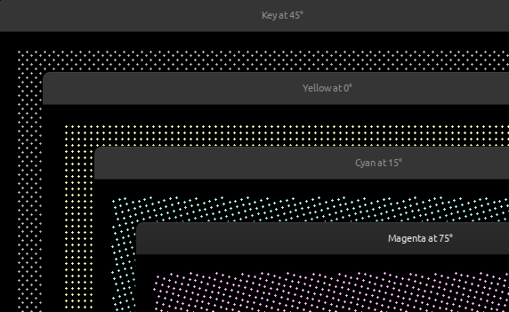

# Rotated grids in Rust

🎨 _For halftone dithering and more._

---

This crate provides a generator for enumerating grid coordinates at a specified frequency along a rotated grid.
This can come in useful e.g. when you want to create halftone dithering grids for CMYK processing:

<div align="center" style="text-align: center">
    
</div>

See e.g. my [opencv-cartoon-effect](https://github.com/sunsided/opencv-cartoon-effect) repo for an almost-real-world 
usage example.

## Usage example

```rust
use rotated_grid::{Angle, Grid, GridCoord};

fn main() {
    let halftone_grids = [
        ("Cyan", 15.0),
        ("Magenta", 75.0),
        ("Yellow", 0.0),
        ("Black", 45.0),
    ];

    for (name, angle) in halftone_grids {
        println!("{name} at {angle}°");

        let grid = Grid::new(16.0, 10.0)
            .spacing(7.0, 7.0)
            .angle(Angle::from_degrees(angle));

        for GridCoord { x, y } in grid {
            println!("{x}, {y}");
        }
    }
}
```

All parameters can also be set as named fields:

```rust
use rotated_grid::{Angle, Grid};

let grid = Grid {
    width: 16.0,
    height: 10.0,
    dx: 7.0,
    dy: 7.0,
    x0: 0.0,
    y0: 0.0,
    angle: Angle::from_degrees(15.0),
};
let positions: Vec<_> = grid.into_iter().collect();
```

You can run the example application using

```shell
cargo run --package cmyk
```

This opens a window that prints a color gradient as a CMYK halftone, with each ink on its own
rotated grid. Keys `1`–`4` toggle the inks, `+`/`-` change the dot spacing and `Space` shows
the source image.
`cargo run --package rotated-rect` opens a window that animates how the grid is computed.
